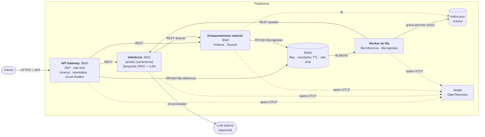
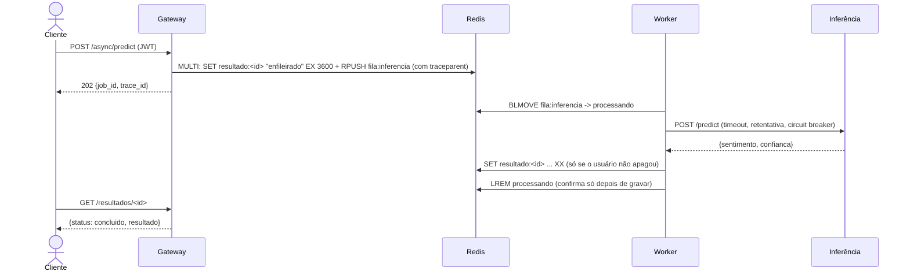

# C3.A2 — Plataforma de IA como Serviço (projeto integrador cloud-native)

**Sistemas Distribuídos e Computação em Nuvem · FAESA · 2026/2** · Prof. Howard Cruz Roatti

Plataforma distribuída que oferece IA como serviço: **análise de sentimento** (síncrona e assíncrona
via fila) e **perguntas e respostas sobre documentos (RAG)**. Ela é conteinerizada, sobe com **um
comando**, é publicada na nuvem com **HTTPS**, é **observável** (rastreamento distribuído com
OpenTelemetry + Jaeger) e é **protegida** (JWT, rate limit, LGPD).

Este repositório reúne o semestre: o RAG distribuído do **C2.A2**
([BiGSerial/sd-2026-2-kit-c2a2](https://github.com/BiGSerial/sd-2026-2-kit-c2a2): índice vetorial,
worker com entrega *pelo menos uma vez*, circuit breaker do LLM) e o serviço de inferência e worker
de fila desenvolvidos sobre o kit do C3.A2.

> A IA é a carga de trabalho, não o objeto de avaliação: o sentimento é um classificador léxico local,
> os embeddings são TF-IDF (scikit-learn, offline) e o LLM tem **modo simulado**. Tudo roda sem
> internet e sem chave de API.

| | |
|---|---|
| **URL pública** | `https://plataforma-ia.onrender.com` — ver [Deploy em nuvem](#deploy-em-nuvem-url-pública-com-https) |
| **Subir localmente** | `docker compose up --build -d` |
| **Documentação interativa** | `http://localhost:8000/docs` (Swagger do gateway) |
| **Rastreamento** | `http://localhost:16686` (Jaeger) |
| **Relatório de trade-offs** | [`docs/RELATORIO_TRADEOFFS.md`](docs/RELATORIO_TRADEOFFS.md) |
| **LGPD (detalhado)** | [`docs/LGPD.md`](docs/LGPD.md) |

---

## Sumário

1. [Arquitetura](#arquitetura)
2. [Como executar do zero](#como-executar-do-zero)
3. [Usando a API](#usando-a-api)
4. [Deploy em nuvem (URL pública com HTTPS)](#deploy-em-nuvem-url-pública-com-https)
5. [Resiliência](#resiliência)
6. [Observabilidade](#observabilidade)
7. [Segurança](#segurança)
8. [Conformidade com a LGPD](#conformidade-com-a-lgpd)
9. [Testes](#testes)
10. [Variáveis de ambiente](#variáveis-de-ambiente)
11. [Extensões opcionais](#extensões-opcionais)
12. [Estrutura do repositório](#estrutura-do-repositório)
13. [Limitações conhecidas](#limitações-conhecidas)

---

## Arquitetura

Quatro microsserviços, exatamente os exigidos pelo edital (**API Gateway + serviço de inferência +
worker de fila + armazenamento vetorial**), mais Redis (filas, resultados, rate limit) e Jaeger
(rastreamento).



| Serviço | Responsabilidade | Comunica por | Código |
|---|---|---|---|
| **gateway** | Única porta pública. Login JWT, rate limit distribuído, roteamento, resiliência, publica jobs na fila | REST (entrada e saída) + fila | [`servicos/gateway/`](servicos/gateway/) |
| **inferencia** | Sentimento (`/predict`) e geração RAG (`/perguntar`: busca trechos e chama o LLM com disjuntor, retentativa e degradação elegante) | REST | [`servicos/inferencia/`](servicos/inferencia/) |
| **vetorial** | Armazenamento vetorial: aceita documentos (enfileira para indexação) e faz a busca por similaridade do cosseno | REST + fila | [`servicos/vetorial/`](servicos/vetorial/) |
| **worker** | Consome as duas filas: jobs assíncronos de sentimento e indexação de documentos (gera os embeddings e grava o índice) | fila + REST | [`servicos/worker/`](servicos/worker/) |
| `servicos/comum` | Código compartilhado: circuit breaker, embeddings, cliente do LLM, índice, rastreamento | — | [`servicos/comum/`](servicos/comum/) |

Cada serviço tem seu `Dockerfile` e seu `requirements.txt` e roda em seu próprio container. Eles só
compartilham o pacote `servicos/comum` (bibliotecas, não chamadas entre serviços).

### Os três fluxos

**1. Sentimento assíncrono (gateway → fila → worker → inferência).** O gateway responde `202` na hora;
o trabalho acontece no worker. O mesmo *trace* cobre as quatro etapas.



**2. Indexação (gateway → vetorial → fila → worker → índice).** Documentos entram pela fila; o worker
reajusta o vocabulário TF-IDF com todos os textos e grava o índice de forma atômica.

**3. Pergunta RAG (síncrona).** Gateway → inferência → vetorial (`/buscar`, top-k por similaridade
do cosseno) → LLM → resposta com `contexto` e `fontes`.

### Decisões principais

- **Fila com entrega pelo menos uma vez.** O worker usa `BLMOVE` para mover a mensagem para uma lista
  "em processamento" e só a apaga **depois** de gravar o resultado/índice. Se cair no meio, ao voltar
  ele devolve as pendentes à fila. Reprocessar é seguro: o resultado é por `job_id` e o índice ignora
  documentos repetidos (hash de texto + origem). Mensagens inválidas vão para `fila:*:erros`.
- **Escritor único do índice** com gravação atômica (arquivo temporário + `fsync` + `os.replace`):
  quem lê nunca vê um índice pela metade.
- **O gateway é o único ponto público.** Inferência, vetorial e Redis só existem na rede interna.
- **Configuração 100% por variável de ambiente**: o mesmo código roda no compose, no Render e no
  Kubernetes.

O porquê de cada escolha (CAP, custo e latência) está em [`docs/RELATORIO_TRADEOFFS.md`](docs/RELATORIO_TRADEOFFS.md).

---

## Como executar do zero

### Requisitos

- **Docker** com **Docker Compose v2** (Docker Desktop no Windows/macOS, ou Docker Engine no Linux).
- **Git**.
- Opcional, para os scripts de teste: **Python 3.10+** com `requests` (`pip install requests`).

### Passo a passo (um comando)

```bash
# 1. Clone o repositório e entre na pasta
git clone https://github.com/yasminsousas/sd-2026-2-kit-c3a2.git
cd sd-2026-2-kit-c3a2

# 2. Suba a plataforma inteira (Redis, Jaeger, gateway, inferência, vetorial e worker)
docker compose up --build -d
```

Não é preciso criar `.env`: os padrões servem para rodar localmente (usuário `admin`, senha `admin123`,
LLM em modo simulado). Para mudar algo, `cp .env.example .env` e edite.

A primeira subida leva alguns minutos (download das imagens e das dependências). Para esperar tudo
ficar saudável: `docker compose up --build -d --wait`. Confira:

```bash
docker compose ps        # todos "running"/"healthy"
curl http://localhost:8000/saude
```

> **Porta 8000 ocupada?** Use outra: `GATEWAY_PORTA=8080 docker compose up --build -d`
> (e `http://localhost:8080` nos comandos abaixo, ou `GATEWAY_URL=http://localhost:8080` nos scripts).

### Verificar o fluxo completo

```bash
python scripts/teste_ponta_a_ponta.py
```

O script passa **só pelo gateway**: testa login/401, inferência síncrona, job assíncrono pela fila
(e a eliminação do resultado), indexação pelo armazenamento vetorial, uma pergunta RAG respondida pelo
documento certo e, no fim, consulta o Jaeger para provar que **o mesmo trace** passou por gateway,
worker e inferência. Saída esperada (resumida):

```
1. gateway no ar e autenticacao JWT ...           ok
2. inferencia sincrona (gateway -> inferencia)     ok
3. inferencia assincrona (gateway -> fila -> worker -> inferencia)  ok
4. armazenamento vetorial ...                      ok
5. RAG: pergunta -> resposta fundamentada          ok
6. rastreamento distribuido no Jaeger
   ok - trace 40a9c1ad5949... cobre ['api-gateway', 'inferencia', 'worker'] (gateway -> fila -> worker)
OK: plataforma funcionando de ponta a ponta
```

### Parar

```bash
docker compose down        # mantém o índice e a fila (volumes)
docker compose down -v     # apaga também os volumes
```

### Sem Docker (opcional, para desenvolvimento)

Requer Python 3.12 e um Redis em `localhost:6379` (por exemplo `docker run -d -p 6379:6379 redis:7.4-alpine`).

```bash
python -m venv .venv && source .venv/bin/activate     # Windows: .venv\Scripts\activate
pip install -r requirements-dev.txt
export DATA_DIR=dados SEMEAR_DOCUMENTOS=documentos     # Windows (PowerShell): $env:DATA_DIR="dados"; ...

uvicorn servicos.vetorial.app:app   --port 8002   # terminal 1
uvicorn servicos.inferencia.app:app --port 8001   # terminal 2
python -m servicos.worker.worker                  # terminal 3
uvicorn servicos.gateway.app:app    --port 8000   # terminal 4
```

Os padrões das URLs internas já apontam para `localhost`.

---

## Usando a API

Todas as rotas, exceto `/`, `/saude`, `/login` e `/docs`, exigem `Authorization: Bearer <token>`.
A documentação interativa (Swagger) fica em `http://localhost:8000/docs`.

```bash
URL=http://localhost:8000     # ou a URL pública

# login -> token JWT
TOKEN=$(curl -s -X POST $URL/login -H 'Content-Type: application/json' \
  -d '{"usuario":"admin","senha":"admin123"}' | python3 -c "import sys,json;print(json.load(sys.stdin)['access_token'])")

# sentimento síncrono
curl -X POST $URL/predict -H "Authorization: Bearer $TOKEN" \
  -H 'Content-Type: application/json' -d '{"texto":"servico excelente"}'

# sentimento assíncrono (fila) e consulta do resultado
curl -X POST $URL/async/predict -H "Authorization: Bearer $TOKEN" \
  -H 'Content-Type: application/json' -d '{"texto":"atendimento pessimo"}'
curl $URL/resultados/<job_id> -H "Authorization: Bearer $TOKEN"
curl -X DELETE $URL/resultados/<job_id> -H "Authorization: Bearer $TOKEN"   # direito de eliminação

# indexar documentos (vão para a fila) e perguntar
curl -X POST $URL/indexar -H "Authorization: Bearer $TOKEN" -H 'Content-Type: application/json' \
  -d '[{"texto":"O teorema CAP trata de consistencia e disponibilidade.","origem":"aula11"}]'
curl -X POST $URL/perguntar -H "Authorization: Bearer $TOKEN" \
  -H 'Content-Type: application/json' -d '{"pergunta":"o que diz o teorema CAP?"}'

# estado da plataforma: dependências, disjuntores, workers vivos e tamanho das filas
curl $URL/saude/detalhada -H "Authorization: Bearer $TOKEN"
```

Ao subir pela primeira vez, o worker indexa sozinho os textos de [`documentos/`](documentos/)
(teorema CAP, consenso Raft, sistemas distribuídos). Para reenviar: `python scripts/indexar_documentos.py`.

| Rota | Auth | Descrição | Respostas |
|---|---|---|---|
| `GET /` | — | Nome, versão e lista de rotas | 200 |
| `GET /saude` | — | *Liveness* (healthcheck do Render/compose) | 200 |
| `POST /login` | — | `{"usuario","senha"}` → `{"access_token","token_type","expira_em_min"}` | 200, 401, 422, 429 (por IP) |
| `GET /saude/detalhada` | JWT | Redis, serviços, disjuntores, workers vivos, filas | 200 |
| `POST /predict` | JWT | Sentimento síncrono | 200, 401, 422, 429, 503 |
| `POST /async/predict` | JWT | Enfileira o job → `{"job_id","status","trace_id","consultar_em"}` | 202, 503 (fila fora) |
| `GET /resultados/{job_id}` | JWT | Status (`enfileirado`/`concluido`/`falha`) e resultado; só o dono vê | 200, 404, 503 |
| `DELETE /resultados/{job_id}` | JWT | Apaga o resultado (LGPD) | 204, 404 |
| `POST /indexar` | JWT | Até 50 documentos `{"texto","origem"}` → fila de ingestão | 202, 422, 503 |
| `GET /documentos` | JWT | Total e contagem por origem (sem textos) | 200 |
| `POST /perguntar` | JWT | `{"pergunta","top_k"}` → `{"resposta","contexto","fontes"}` | 200, 503 `degradado` |

Toda resposta traz o header **`X-Trace-ID`**: o id do trace OpenTelemetry, para achar a requisição no
Jaeger e nos logs.

---

## Deploy em nuvem (URL pública com HTTPS)

Plataforma: **Render, plano gratuito** (sem cartão). O arquivo [`render.yaml`](render.yaml) é um
*Blueprint* que cria tudo de uma vez:

- `plataforma-ia` — Web Service Docker com os 4 microsserviços como **processos separados** numa imagem
  ([`deploy/render/`](deploy/render/)), com o gateway como único processo exposto;
- `plataforma-ia-redis` — Key Value (Redis) gratuito, acessível só pela rede privada.

Por que uma imagem só: no plano gratuito cada serviço dorme após 15 min sem tráfego e a conta tem
750 h/mês — 4 serviços não caberiam, e o worker (que não recebe HTTP) dormiria. A imagem foi testada
com limite de 512 MB e usa ~282 MB.

**HTTPS:** o Render emite e renova o certificado automaticamente em `https://<nome>.onrender.com`;
o gateway envia `Strict-Transport-Security` quando a requisição chega por HTTPS.

### Passo a passo

1. Crie uma conta em <https://render.com> (entrar com o GitHub é o mais simples).
2. **New → Blueprint**, selecione este repositório e a branch `main`.
3. Preencha `SENHA_PADRAO` (senha do usuário `admin`). `JWT_SEGREDO` é gerado pelo Render.
   `LLM_API_KEY` e `OTEL_EXPORTER_OTLP_*` são opcionais (deixe em branco).
4. **Apply** e aguarde o primeiro deploy (alguns minutos).
5. Teste a URL pública com o mesmo script de ponta a ponta:

```bash
GATEWAY_URL=https://plataforma-ia.onrender.com SENHA='<sua senha>' python scripts/teste_ponta_a_ponta.py
```

A cada `git push` na `main` o Render publica de novo sozinho (`autoDeploy`). Detalhes, como manter
o serviço acordado (monitor gratuito chamando `/saude`) e as limitações do plano gratuito estão em
[`deploy/INSTRUCOES.md`](deploy/INSTRUCOES.md).

> Se o nome `plataforma-ia` já estiver em uso no Render, ele gera outro subdomínio. Nesse caso,
> atualize a URL na tabela do topo deste README.

---

## Resiliência

| Mecanismo | Onde | Como |
|---|---|---|
| **Tempo-limite** | gateway → serviços (`GATEWAY_TIMEOUT` 5 s; `/perguntar` 40 s), worker → inferência (5 s), inferência → LLM (`LLM_TIMEOUT` 10 s), inferência → vetorial (10 s) | Nenhuma chamada fica pendurada |
| **Retentativa com backoff exponencial** | gateway (3×, 0,3 s · 2ⁿ + *jitter*), worker (3×, 0,5 s · 2ⁿ), LLM (3×, 0,5 s · 2ⁿ) | Só para erros **transitórios** (timeout, conexão, 5xx, 408, 429). 400/401/403/404 não são repetidos. `/indexar` não é repetido após timeout de leitura (não idempotente) |
| **Circuit breaker** | Um por dependência: gateway→inferência, gateway→vetorial, gateway→Redis (rate limit), worker→inferência, inferência→LLM, inferência→vetorial | Fechado → aberto após N falhas seguidas (recusa na hora, `503` + `Retry-After`) → meio-aberto (uma única sonda) → fechado. Thread-safe, relógio monotônico, ignora resultados obsoletos |
| **Degradação elegante** | `/perguntar` | Com o LLM fora, responde `503` com `"degradado": true` **e ainda entrega os trechos e as fontes**. O gateway repassa sem retentar (não multiplica as chamadas ao LLM) |
| **Fila durável** | worker | `BLMOVE` + confirmação após gravar; recuperação de pendentes ao iniciar e após queda do Redis; com o circuito da inferência aberto, o job volta à fila em vez de ser perdido |
| **Rate limit tolerante a falhas** | gateway | Se o Redis cair, o limite passa a ser contado em memória (degrada, não derruba) |
| **Reinício automático** | compose (`restart: unless-stopped`), Render (`start.sh` derruba o container se um processo morrer) | — |

### Demonstração com falhas reais

```bash
docker compose --env-file .env.demo --profile demo up --build -d --wait
python scripts/teste_resiliencia.py --docker
docker compose --profile demo down
```

O perfil `demo` sobe um **LLM falso** ([`scripts/llm_falso.py`](scripts/llm_falso.py)) que pode
ficar saudável, quebrado (500), limitado (429), recusar a chave (401) ou ficar lento, e que **conta as
chamadas recebidas**. O script prova, pelo gateway:

1. erro permanente (401): nenhuma retentativa e o circuito não abre;
2. erro transitório (500): 3 tentativas, resposta degradada com contexto, circuito abre;
3. circuito aberto: 503 em ~10 ms e **0** chamadas ao LLM; fecha sozinho quando o LLM volta;
4. LLM lento: o tempo-limite corta cada tentativa;
5. inferência derrubada: o disjuntor do **gateway** abre (503 imediato com `Retry-After`), o caminho
   assíncrono continua aceitando jobs e **o job enfileirado durante a queda é processado depois**;
6. worker parado: o job espera na fila e é concluído quando o worker volta;
7. Redis parado: `/async/predict` responde 503 honesto, `/predict` continua funcionando, e tudo
   reconecta sozinho.

---

## Observabilidade

**Rastreamento distribuído com OpenTelemetry**, cobrindo gateway, fila e worker
([`servicos/comum/rastreamento.py`](servicos/comum/rastreamento.py)):

- **HTTP:** FastAPI (servidor) e `requests` (cliente) instrumentados; o contexto viaja no header W3C
  `traceparent`.
- **Fila:** o Redis não tem headers, então o produtor injeta o contexto **dentro da mensagem** (campo
  `_trace`) num span `PRODUCER`, e o worker o extrai e continua o **mesmo trace** num span `CONSUMER`.
- **Exportação:** OTLP/HTTP para o **Jaeger** do compose. Abra <http://localhost:16686>, escolha o
  serviço `api-gateway` e veja um trace de `/async/predict` atravessar
  `api-gateway → fila.publicar → worker (fila.consumir) → inferencia /predict`.
- **Correlação:** o `trace_id` volta no header `X-Trace-ID` e aparece em todas as linhas de log
  (`trace_id=...`), inclusive no worker.
- **Saúde:** `GET /saude/detalhada` mostra dependências, estado de cada disjuntor, workers vivos
  (batimento no Redis) e tamanho das filas.
- **No Render:** sem `OTEL_EXPORTER_OTLP_ENDPOINT` os spans não são exportados, mas `X-Trace-ID` e os
  logs correlacionados continuam funcionando. Para ter traces na nuvem, aponte para um coletor OTLP
  gratuito (ex.: Grafana Cloud) com `OTEL_EXPORTER_OTLP_ENDPOINT` e `OTEL_EXPORTER_OTLP_HEADERS`.

---

## Segurança

- **JWT (HS256)** emitido em `POST /login`, validando `exp`, `iat` e `iss`; rotas protegidas
  respondem `401` com `WWW-Authenticate`. Senha comparada em tempo constante (`hmac.compare_digest`).
- **Segredos fora do código:** `JWT_SEGREDO`, `SENHA_PADRAO` e `LLM_API_KEY` vêm de variáveis de
  ambiente (no Render, `JWT_SEGREDO` é gerado e a senha é digitada no painel). Com
  `AMBIENTE=producao`, o gateway **se recusa a iniciar** sem segredo forte (32+ caracteres) e senha
  definidos.
- **Rate limit distribuído** no Redis: `RATE_LIMIT_RPM` por usuário (padrão 30/min) e
  `LOGIN_RATE_LIMIT_RPM` por IP no login (padrão 10/min, contra força bruta). `429` com `Retry-After`.
- **HTTPS** no serviço publicado (certificado automático do Render) + HSTS.
- **Superfície mínima:** só o gateway é público; Redis e serviços internos não têm porta publicada.
  Containers rodam como usuário não-root. Limites de tamanho em todos os campos e no corpo (413).
- Headers `X-Content-Type-Options`, `X-Frame-Options`, `Referrer-Policy` e `Cache-Control: no-store`.

---

## Conformidade com a LGPD

Resumo (mapeamento completo, bases legais e direitos do titular em [`docs/LGPD.md`](docs/LGPD.md)):

| Dado tratado | Finalidade | Por quanto tempo |
|---|---|---|
| Usuário e senha do login | Autenticar | **Não armazenados**: comparados em memória e descartados |
| Token JWT | Autorizar as chamadas seguintes | Não armazenado no servidor; expira em **60 min** (`JWT_EXPIRACAO_MIN`) |
| Texto enviado para análise de sentimento | Executar a análise pedida | Na fila só até ser processado (segundos); **não** vai para o LLM nem para logs |
| Resultado da análise | Devolver ao usuário | **1 hora** (`TTL_RESULTADOS_SEG=3600`) ou até `DELETE /resultados/{job_id}` |
| Pergunta RAG | Responder | **Não armazenada** (só durante a requisição). Só sai da plataforma se `LLM_API_KEY` estiver configurada (vai ao provedor do LLM com os trechos) |
| Documentos indexados | Base de conhecimento do RAG | Até serem removidos do índice — **não indexe dados pessoais** |
| Identificador do usuário | Dono do job e rate limit | Só como **hash SHA-256 truncado**; 1 h (dono do job) e 60 s (rate limit) |
| IP | Rate limit do login | Só como hash, janela de 60 s; não vai para log (`--no-access-log`) |
| Mensagens inválidas | Diagnóstico | Fila de erros limitada a 100 mensagens e expirada em **7 dias** |
| Logs | Operação e depuração | **Sem conteúdo**: só método, rota, status, latência, `trace_id`, `job_id` e tamanhos |

Direitos do titular: acesso (`GET /resultados/{id}`) e **eliminação** (`DELETE /resultados/{id}`,
que também impede o worker de recriar o resultado de um job ainda na fila).

---

## Testes

**Testes automatizados** (180, `unittest`, rápidos e determinísticos, sem rede): circuit breaker
(estados, concorrência, sonda única, resultados obsoletos), gateway (JWT, rate limit com e sem Redis,
dono do job, disjuntor, retentativa, repasse do 503 degradado), worker (entrega pelo menos uma vez,
queda do Redis, mensagens inválidas, circuito aberto, eliminação durante o processamento), índice
vetorial, busca e geração RAG.

```bash
python -m venv .venv && source .venv/bin/activate
pip install -r requirements-dev.txt
python -m unittest discover -s tests
```

| Script (com a stack no ar) | O que prova |
|---|---|
| `python scripts/teste_ponta_a_ponta.py` | Todos os fluxos pelo gateway + trace único no Jaeger |
| `python scripts/teste_resiliencia.py --docker` | Falhas reais de LLM, inferência, worker e Redis (perfil `demo`) |
| `python scripts/medir_latencia.py 30` | Latências p50/p95 usadas no relatório |
| `python scripts/indexar_documentos.py` | Reindexa `documentos/` |

Todos aceitam `GATEWAY_URL`, `USUARIO` e `SENHA`, então rodam também contra a URL pública.

---

## Variáveis de ambiente

Principais (todas têm padrão; veja [`.env.example`](.env.example) e o [`docker-compose.yml`](docker-compose.yml)):

| Variável | Padrão | Serviço | Efeito |
|---|---|---|---|
| `AMBIENTE` | `desenvolvimento` | gateway | `producao` exige `JWT_SEGREDO` forte e `SENHA_PADRAO` |
| `JWT_SEGREDO` | valor de dev no compose | gateway | Segredo HS256 (32+ caracteres em produção) |
| `JWT_EXPIRACAO_MIN` | `60` | gateway | Validade do token |
| `USUARIO_PADRAO` / `SENHA_PADRAO` | `admin` / `admin123` (dev) | gateway | Credenciais do `/login` |
| `RATE_LIMIT_RPM` / `LOGIN_RATE_LIMIT_RPM` | `30` / `10` | gateway | Limite por usuário / por IP no login |
| `GATEWAY_TIMEOUT` / `GATEWAY_TIMEOUT_PERGUNTAR` | `5` / `40` | gateway | Tempo-limite das chamadas internas (s) |
| `GATEWAY_TENTATIVAS` / `GATEWAY_BACKOFF` | `3` / `0.3` | gateway | Retentativas e espera base |
| `GATEWAY_LIMITE_FALHAS` / `GATEWAY_ESPERA_CIRCUITO` | `5` / `30` | gateway | Falhas que abrem o circuito / segundos aberto |
| `GATEWAY_PORTA` | `8000` | compose | Porta do gateway no host |
| `BIND_ADDR` | `127.0.0.1` | compose | Endereço em que gateway e Jaeger são publicados |
| `TTL_RESULTADOS_SEG` | `3600` | gateway, worker | Retenção dos resultados (LGPD) |
| `REDIS_URL` | `redis://redis:6379/0` | todos | Filas, resultados e rate limit |
| `URL_INFERENCIA` / `URL_VETORIAL` | nomes do compose | gateway, worker, inferência | Endereço dos serviços internos |
| `DATA_DIR` | `/dados` | vetorial, worker | Pasta do `indice.json` |
| `SEMEAR_DOCUMENTOS` | `/app/documentos` | worker | Indexa os `.txt` se o índice estiver vazio |
| `WORKER_FILAS` | `inferencia,ingestao` | worker | Quais filas este processo consome |
| `WORKER_TIMEOUT` / `WORKER_TENTATIVAS` / `WORKER_BACKOFF` | `5` / `3` / `0.5` | worker | Chamada à inferência |
| `WORKER_LIMITE_FALHAS` / `WORKER_ESPERA_CIRCUITO` | `5` / `15` | worker | Disjuntor do worker |
| `FILA_ERROS_MAX` / `FILA_ERROS_TTL_SEG` | `100` / `604800` | worker | Limite e expiração das filas de erro |
| `LLM_API_KEY` | vazio | inferência | Vazio = **modo simulado**; nunca no código |
| `LLM_API_URL` / `LLM_MODELO` | OpenAI / `gpt-4o-mini` | inferência | Endpoint e modelo do LLM |
| `LLM_TIMEOUT` / `LLM_TENTATIVAS` / `LLM_BACKOFF` | `10` / `3` / `0.5` | inferência | Proteção da chamada ao LLM |
| `LLM_LIMITE_FALHAS` / `LLM_ESPERA_CIRCUITO` | `3` / `20` | inferência | Disjuntor do LLM |
| `OTEL_EXPORTER_OTLP_ENDPOINT` | `http://jaeger:4318` (compose) | todos | Para onde os spans vão (vazio = não exporta) |
| `OTEL_SERVICE_NAME` | nome do serviço | todos | Nome no Jaeger |

---

## Extensões opcionais

| Extensão do edital | Situação |
|---|---|
| **Pipeline de CI/CD** | [`.github/workflows/ci.yml`](.github/workflows/ci.yml): testes, build das 5 imagens, teste de fumaça com `docker compose up --wait` + ponta a ponta, publicação no GHCR na `main`. O Render republica a cada push (`autoDeploy`) |
| **Manifests de Kubernetes** | [`k8s/`](k8s/): kustomize com namespace, Redis (StatefulSet), Jaeger, os 4 serviços, Ingress com TLS (cert-manager), PDB, NetworkPolicy, pods não-root. Validados com `kubectl kustomize` + `kubeconform` |
| **Autoescalonamento conforme a fila** | [`k8s/keda.yaml`](k8s/keda.yaml): KEDA escala `worker-inferencia` (1 a 5 réplicas) pelo tamanho de `fila:inferencia`; o worker de ingestão fica com 1 réplica (escritor único) |
| Painel de métricas | Parcial: `GET /saude/detalhada` (disjuntores, workers vivos, filas) e o Jaeger (latência por span) |
| Serverless / borda | Não implementado |

---

## Estrutura do repositório

```
.
├── servicos/
│   ├── comum/          # circuit_breaker · embeddings (TF-IDF) · llm · indice (vetorial) · rastreamento (OTel)
│   ├── gateway/        # app · autenticacao (JWT) · limite (rate limit) · resiliencia · config
│   ├── inferencia/     # app (/predict, /perguntar) · sentimento
│   ├── vetorial/       # app (/indexar, /buscar, /documentos)
│   └── worker/         # worker · consumidor_inferencia · consumidor_ingestao
│       └── (cada serviço com Dockerfile e requirements.txt próprios)
├── documentos/         # textos de exemplo indexados na primeira subida
├── tests/              # 180 testes automatizados (unittest)
├── scripts/            # teste_ponta_a_ponta · teste_resiliencia · medir_latencia · indexar_documentos · llm_falso
├── deploy/             # INSTRUCOES.md + render/ (imagem única e start.sh do Render)
├── k8s/                # manifests de Kubernetes + KEDA (extensões)
├── docs/               # RELATORIO_TRADEOFFS.md · LGPD.md
├── .github/workflows/  # CI/CD
├── docker-compose.yml  # sobe tudo com um comando (+ perfil demo com o LLM falso)
├── render.yaml         # Blueprint do deploy em nuvem
├── requirements-dev.txt
└── TAREFAS.md          # checklist do edital
```

---

## Limitações conhecidas

- **Busca TF-IDF lexical** (sem sinônimos) e recalculada a cada consulta: ótima para dezenas de
  trechos, mas cresce rápido (2000 documentos ≈ 7,6 s). Mitigações no relatório.
- **Redis único**: ponto único de falha; no Render gratuito ele não persiste (reinício perde jobs
  pendentes e resultados).
- **Render gratuito**: dorme após 15 min sem tráfego (primeira requisição ~1 min) e o disco é
  efêmero (o índice é semeado de novo a partir de `documentos/` a cada deploy).
- **Usuário único** configurado por variável de ambiente; não há cadastro de usuários nem revogação de
  token antes da expiração.
- Remover um documento do índice ainda é manual.

---

## Contribuidores

- Eve Chalabi
- Yasmin Neumann
- Yasmin Sousa
- Wilton Carvalho
